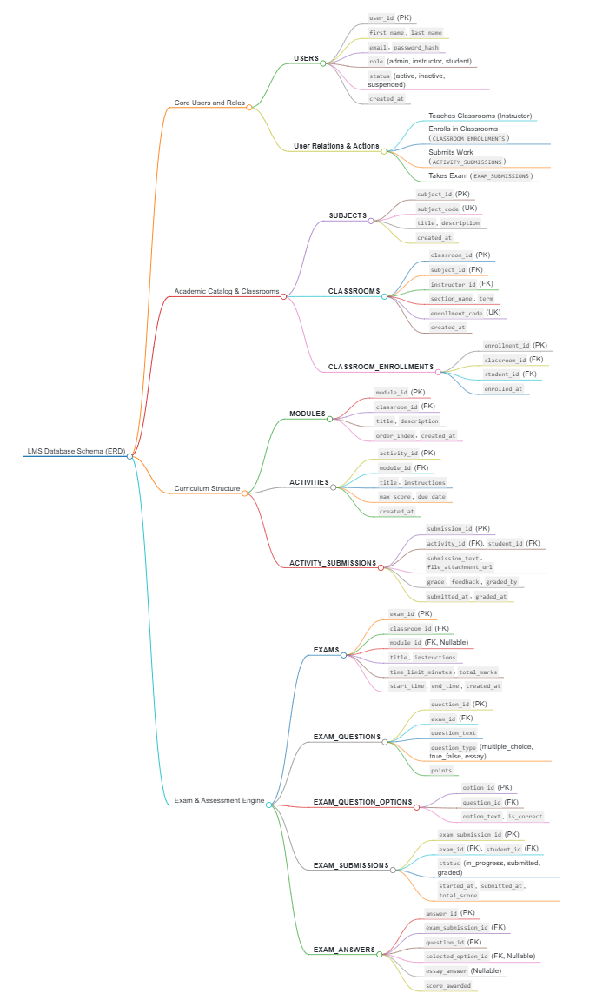

# Architecture and data flow

The app is a React and Vite frontend, adopting TypeScript file by file. Student and Instructor are the rebuilt UIs in `src/features/` (cut over 2026-11-17, D-021); Admin was rebuilt in `src/features/admin` on the same shell and design system (D-038). Feature `api/` modules read and write the browser-local role store through TanStack Query, so the .NET API can replace the storage adapter without screen changes. `src/main.tsx` mounts the app providers and React Router; one catch-all route selects `/student`, `/instructor`, or `/admin` with the legacy `roleRouter.js` parser, so query, hash, `.html`, and subpath URLs resolve as before. `src/shared/layout/AppShell.tsx` is the responsive Student/Instructor shell (sidebar, Student bottom bar, Instructor drawer, skip link, connection banner); `src/features/admin/data/RoleWorkspace.jsx` remains the Admin shell. `src/features/admin/data/lmsData.js` seeds ERD-shaped demo records, while `storage.js` shares them through browser localStorage. `src/features/student`, `src/features/instructor`, and `src/features/admin/data/Admin.jsx` implement the three role workspaces.

The shared model follows the ERD: users, subjects, classrooms, enrollments, modules, materials, activities, activity submissions, exams, and exam submissions. Exam questions and their options are nested within each exam; answer and per-question-grade maps are nested within each submission. IDs link classroom records to their subjects, instructor, modules, and students. Materials and gradebook settings extend the supplied ERD for prototype needs.

## Supplied ERD

This is the schema reference supplied for the prototype. The frontend model adapts it for browser-local demonstration data.

Student and Instructor data come from the LMS API (D-032): each workspace loads one overview for the person being viewed (`GET /api/me/overview`) and sends every change to the API, which checks access, validates, scores exams and writes metadata-only audit rows. `features/instructor/api/store.ts` and `features/student/api/catalog.ts` map the overview into the shapes the screens already used. Admin still keeps its own browser-local demo data under `tmcc-lms-roles-v1`; it no longer reflects what instructors and students do.

Admin's activity and completion summaries read its browser-local demo data; the Student and Instructor workspaces no longer write to it.

Admin pages sit under plain sidebar section labels, one click each (D-038). The Overview has four metric cards, a wide course-activity panel with supporting panels, and a recent-activity table; charts are plain bars with their numbers. System configuration, terms, role-matrix values, and metadata-only audit events share `tmcc-lms-roles-v1`. `src/features/admin/data/systemAdministrationData.js` owns migration, audit filtering/pagination, report rows, and full snapshot construction; `storage.js` stores the latest snapshot separately. The scheduled-job card is display-only. Reset Demo first stores the current shared state as a snapshot, then writes fresh seed data; it aborts if either storage operation fails. Role permissions remain visual and are not authorization controls. Audit summaries omit answers, submission text, comments, and feedback.

The current role UI is an initial connected prototype: exam authoring supports a single multiple-choice question, and assignment attachments store a filename and comment only. Essay grading, other question types, exam-wide timers and attempt/review policies, full enrollment editing, and a student roster picker remain outside this implementation slice even though the ERD and flow documents describe them.

## Boundaries

There is no user sign-in yet: the Student and Instructor workspaces send a demo identity (`X-Demo-User-Id`, `X-Demo-Role`) that the LMS API accepts only in Development and Demo mode, and the API enforces access against it. The path is: browser -> LMS API (`../server`, port 5200) -> ISMS API (`../isms-api`, port 5100) -> ISMS database. The ISMS API checks an API client's id and key, then that client's permission for the operation, and exposes read-only routes; the LMS API holds no ISMS database connection. The LMS API stores LMS-owned data in its own MySQL database, `lmsdb`, with a synced copy of ISMS classes and class lists. The browser tests run against the API in Demo mode (fictional seed, one SQLite database per test). There is no upload service: attachments are file names.

Enumeration uses case-insensitive, order-independent exact matching; matching uses case-insensitive exact text in the corresponding order. Essays await manual grading. Gradebook values use the latest activity submission and the highest or latest graded exam attempt as configured. Category averages use graded items only, so an overall is illustrative and does not account for missing work. An overall is shown only after each non-zero weighted category has a grade.

### Admin overview layout — 2026-10-29

The Orbit screenshot guides Overview proportions: four compact KPI cards, a two-thirds Course Activity chart beside a one-third classroom-status summary, and a full-width recent-activity table. Supporting analytics retain three equal columns beneath the table. Workspace management actions are located in their respective sections and tabs. Narrow layouts stack panels and contain table scrolling. Status counts use the selected term across all dates; the latest five activity rows reuse the existing term/date-filtered events and suppress duplicate course/system entries. Empty activity remains explicitly empty, and sample chart values stay labeled. SVG hover coordinates use the screen transformation to handle aspect-ratio padding.

Recent workspace activity uses `src/features/admin/data/mockWorkspaceActivity.js` for a display-only fallback when the filtered LMS event feeds are empty. The panel explicitly labels these fictional rows as sample activity; preview dates are relative to the dashboard calculation time. Actual scoped events take priority, with cross-feed duplicates removed and the latest five displayed. Fixtures never modify shared storage, audit logs, chart counts, or report exports.
