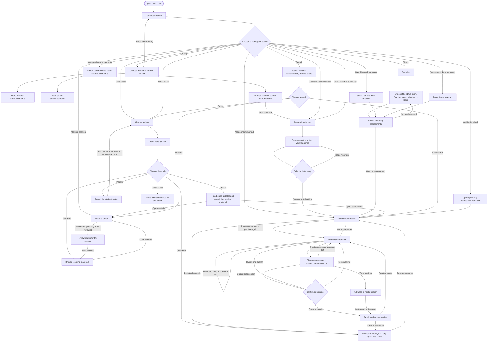

# Student user flow

This chart describes the student-facing flows implemented in the TMCC LMS prototype. Begin at **Today**; the prototype has no sign-in screen or server account. All names, classes, events, and assessments are fictional demo data.

**Standalone flowchart image:** [Open the scalable SVG](flowcharts/tmcc-student-user-flow.svg). It uses standard process, decision, start/end, and letter-connector symbols.

## How to read this flow

- **Today** is the starting point and the workspace breadcrumb returns to it. The dashboard can switch between Overview and News & announcements; its due, completed, activity, class, assessment, and material shortcuts open the corresponding workspace path.
- The **academic calendar** is opened from the top bar or the dashboard. Assessment entries lead to assessment details; school events are informational entries.
- **Tasks** groups assessments by due status. Selecting an assessment opens the same details view as calendar, notifications, search, and classwork.
- A **class** opens on Stream. Its tabs provide Stream, Classwork, Materials, People, and Attendance. Attendance lists the student's own months, newest first: days present, school days, and attendance % (days present ÷ school days × 100), or "Not recorded" when the instructor has not entered their days. It is not counted in grades yet (D-035). Assessment and material detail back buttons return to their matching class tab.
- Starting an assessment starts, or resumes, an attempt on the LMS API, which sends the questions without their answers. Each question has its own 60-second timer in the browser; the server enforces the exam's overall time limit and attempt limit. Answers save to the server as the student works. Timeouts advance automatically; the final timeout submits. Manual submission asks for confirmation before showing the result.
- The server scores multiple-choice and true/false answers on submit; the result shows the score and which questions were right without revealing the correct options. Work handed in and grades are stored by the LMS API (D-032). Material review state lasts only for the current app session. Today's "Choose demo student" switches which student the workspace shows; this is a demo identity, not a sign-in.

## Prototype boundaries

There is no sign-in yet: the student is a demo identity chosen on Today, which the LMS API accepts only in Development and Demo mode. Work, attempts and grades are saved by the LMS API; attachments are file names only. The academic calendar is sample data, not an official TMCC schedule.

## Since the rebuild (2026-11-17)

The journeys above are unchanged and are verified by `e2e/student-flow.spec.ts` and `e2e/shell.spec.ts`. The rebuilt UI adds:

- **Every screen has a URL** (`/student/tasks?status=Missing`, `/student/classes/<id>?tab=Materials`, `/student/assessments/<id>/quiz`, …), so Back, Forward, refresh, and shared links work.
- **Tasks** shows the four statuses as one-tap filters with counts instead of a dropdown.
- **Exams show the instructor's grade and feedback** on the assessment page once graded, plus "View your result" (D-015).
- **Quiz:** number keys 1–4 pick answers, the timer and progress stay visible while scrolling, and timer milestones are announced politely. Per-question timers keep the same rules but are timestamp-based, so a sleeping phone cannot slow them.
- **Navigation (D-023):** Dashboard (formerly Today), My Classes, Tasks & Assessments, Calendar, and News & Announcements, which is now its own page instead of a toggle on the dashboard. On phones these are in the bottom bar (Dashboard, Classes, Tasks, Calendar, News), with a search sheet.
- **Dashboard:** greeting with the date and term week, summary chips, Tasks & Assessments with due-date pills, My Classes, an Academic Calendar timeline, and the latest announcement.
- **Offline:** after one visit the app opens without a connection, and answers keep saving on the device.

Implementation references: [Student workspace](../src/features/student/StudentApp.tsx), [screens](../src/features/student/pages/), [data and rules](../src/features/student/api/), [fictional seed data](../src/data.js), and [project scope](PROJECT_BRIEF.md).
