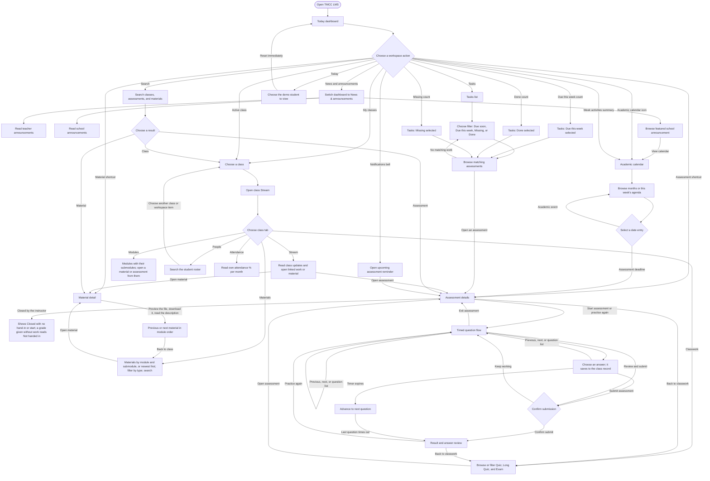

# Student user flow

This chart describes the student-facing flows implemented in the TMCC LMS prototype. Begin at **Today**; the prototype has no sign-in screen or server account. All names, classes, events, and assessments are fictional demo data.

**Standalone flowchart image:** [Open the scalable SVG](flowcharts/tmcc-student-user-flow.svg). It uses standard process, decision, start/end, and letter-connector symbols.

## How to read this flow

- **Today** is the starting point and the workspace breadcrumb returns to it. The dashboard can switch between Overview and News & announcements; its due, completed, activity, class, assessment, and material shortcuts open the corresponding workspace path.
- The **academic calendar** is opened from the top bar or the dashboard. Assessment entries lead to assessment details; school events are informational entries.
- **Tasks** groups assessments by due status. Selecting an assessment opens the same details view as calendar, notifications, search, and classwork.
- A **class** opens on Stream. Its tabs provide Stream, Classwork, Modules, Materials, People, and Attendance. Modules (D-033) shows each module with its submodules nested under it and the materials and assessments placed in each. Attendance lists the student's own months, newest first: days present, school days, and attendance % (days present ÷ school days × 100), or "Not recorded" when the instructor has not entered their days. It is not counted in grades yet (D-035). Assessment and material detail back buttons return to their matching class tab.
- Starting an assessment starts, or resumes, an attempt on the LMS API, which sends the questions without their answers. Each question has its own 60-second timer in the browser; the server enforces the exam's overall time limit and attempt limit. Answers save to the server as the student works. Timeouts advance automatically; the final timeout submits. Manual submission asks for confirmation before showing the result.
- The server scores multiple-choice and true/false answers on submit; the result shows the score and which questions were right without revealing the correct options. Work handed in and grades are stored by the LMS API (D-032). Material review state lasts only for the current app session. Today's "Choose demo student" switches which student the workspace shows; this is a demo identity, not a sign-in.

## Prototype boundaries

There is no sign-in yet: the student is a demo identity chosen on Today, which the LMS API accepts only in Development and Demo mode. Work, attempts, grades and uploaded assignment files are saved by the LMS API (D-055, D-060). The academic calendar is sample data, not an official TMCC schedule.

## Since the rebuild (2026-11-17)

The journeys above are unchanged and are verified by `e2e/student-flow.spec.ts` and `e2e/shell.spec.ts`. The rebuilt UI adds:

- **Every screen has a URL** (`/student/tasks?status=Missing`, `/student/classes/<id>?tab=Materials`, `/student/assessments/<id>/quiz`, …), so Back, Forward, refresh, and shared links work.
- **Tasks** shows the four statuses as one-tap filters with counts instead of a dropdown.
- **Exams show the instructor's grade and feedback** on the assessment page once graded, plus "View your result" (D-015).
- **Quiz:** number keys 1–4 pick answers, the timer and progress stay visible while scrolling, and timer milestones are announced politely. Per-question timers keep the same rules but are timestamp-based, so a sleeping phone cannot slow them.
- **Navigation (D-023):** Dashboard (formerly Today), My Classes, Tasks & Assessments, Calendar, and News & Announcements, which is now its own page instead of a toggle on the dashboard. On phones these are in the bottom bar (Dashboard, Classes, Tasks, Calendar, News), with a search sheet.
- **Dashboard (D-066, D-071):** greeting with the date and term week, the Next due tile with the latest announcements beside it, then Tasks & Assessments (status buttons that count the work due this week, missing, and done, over the next deadlines with due-date pills) beside an Academic Calendar timeline, and My Classes as one row of cards that scrolls sideways when they outnumber the width.
- **Offline:** after one visit the app opens without a connection, and answers keep saving on the device.
- **Closed activities** (D-036): once the instructor closes an assignment or assessment it shows **Closed** and offers no hand-in or start; a grade the instructor gave without anything handed in reads **Not handed in** with the score (`e2e/close-activities.spec.ts`).
- **Handing in an assignment** (D-060): the assignment page lists the instructions and the rules in plain words, and a **Your work** card shows the state (Assigned, Draft, Turned in, Missing, Graded, Returned, Not handed in, and Late). The written answer and link save as the student types; files are chosen (or photographed on phones) and upload one at a time with progress, Cancel, and Retry or Remove when one is refused. **Turn in** confirms exactly what is handed in (and "This is my own work" when asked), then shows a receipt with the time, the version, and each file's code, which stays after a reload. **Take back** and **Turn in a new version** appear when the assignment allows them; earlier versions are listed. Past the due date with late work off, the card gives the reason and nothing can be edited. Uploading and turning in need a connection, and the card says so offline (`e2e/assignment-work.spec.ts`).
- **Own due dates, excused work, late penalties and rubrics** (D-065): when the instructor gave the student more time, the page, the rules and every list (Tasks, Today, Calendar) use the student's own due date, and the rules say "Your due date: … (your instructor gave you more time)". An excused student sees **Excused** and that nothing needs to be handed in and it does not count toward their grade; there is no editor or Turn in, work already handed in stays visible, and the assignment is never due or missing in their lists. Late work with a penalty: the turn-in confirmation says what turning in now loses, and the grade shows the points given, the percent taken off and days late, and the score after it, or "Late penalty waived". An assignment with a rubric shows it before handing in, and the grade shows the level chosen for each criterion. A grade held until returned shows none of this (`e2e/assignment-work-more.spec.ts`).
- **Question types** (D-040): besides multiple choice, quizzes can ask true or false, identification, enumeration, essay, modified true or false (the underlined phrase is read out), and matching. Section directions sit above their questions; the assessment page and the quiz header say how spelling is checked. Typed answers save on their own (D-043), and the submit dialog lists unanswered questions.
- **Results** show Correct, Partly correct, Incorrect, or Waiting for grading per question, spelling notes, and the correct answers only when the instructor allows it; "Your score was updated" appears after the instructor fixes a key (`e2e/quiz-types.spec.ts`).

Implementation references: [Student workspace](../src/features/student/StudentApp.tsx), [screens](../src/features/student/pages/), [data and rules](../src/features/student/api/), [fictional seed data](../src/data.js), and [project scope](PROJECT_BRIEF.md).
