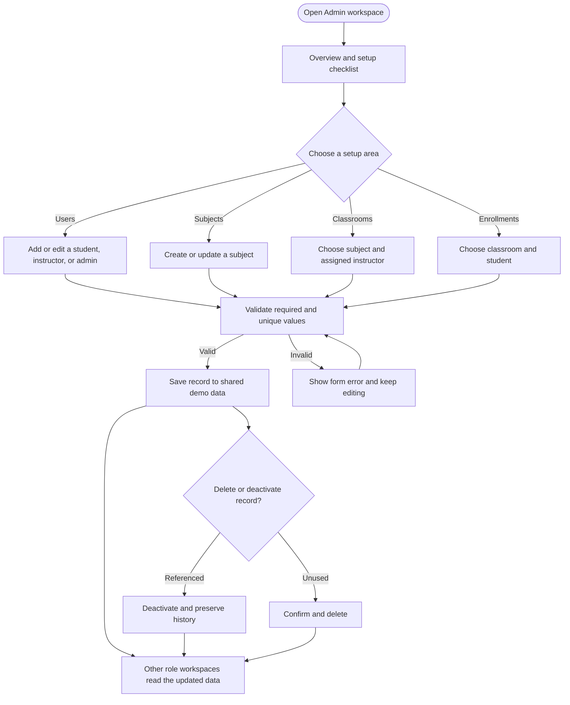

# Admin user flow

This flow describes the admin workspace in the TMCC LMS prototype. Open **Admin** from the role picker or go directly to `/admin`; there is no sign-in screen. Admin records are fictional and shared with the student and instructor workspaces in this browser.

**Standalone flowchart:** [Open the admin flow SVG](flowcharts/tmcc-admin-user-flow.svg).

## How to read this flow

- **Overview** shows active record counts and direct setup links for people, subjects, classrooms, and enrollments.
- **Users** creates and edits fictional people with student, instructor, or admin roles. Email addresses must be unique. A user with existing assignments or submissions cannot change roles.
- **Subjects** defines the catalog entry. **Classrooms** connect a subject to an instructor and define section, term, and enrollment code. **Enrollments** link a student to a classroom; active duplicate enrollment is blocked.
- Forms validate required fields and unique codes before saving. Records referenced by classes, enrollment, or submissions cannot have linked identities changed.
- Deleting an unused record removes it after confirmation. When history refers to a record, the action deactivates it and preserves the linked history.
- Saved changes are visible to the other role workspaces in the same browser. The top bar switches role and demo user.

## Completion states and prototype boundaries

Successful saves update the shared local data and return to the selected record list. Validation errors keep the form open. Referenced records are deactivated rather than deleted. This is a client-only demonstration without real authentication, server authorization, audit history, multi-user concurrency, or cross-device sync. Do not enter real student data.

Implementation references: [Admin workspace](../src/roles/admin/Admin.jsx), [shared role data](../src/roles/shared/lmsData.js), [project brief](PROJECT_BRIEF.md), and [ERD](lms-erd.png).
