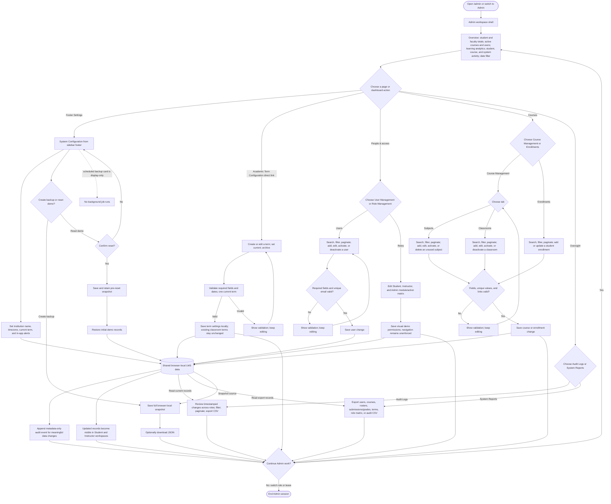

# Admin user flow

This flow documents the complete Admin journey in the TMCC LMS prototype: open the workspace, review the dashboard, configure the institution and academic term, manage people and courses, inspect audit history and reports, back up or reset demo data, and then return to Admin or leave the workspace. The workspace has no sign-in or authorization step. All records are fictional and browser-local.

The Mermaid diagram below is the editable end-to-end Admin flow.

## Flow stages

1. **Enter and orient:** Admin opens `/admin` or switches into the Admin workspace. Overview presents the shared-data counts, learning analytics, weekly student/course/system activity, recent event feed, and date range controls. Dashboard actions can open the matching creation form.
2. **Configure the system:** Admin updates browser-local institution defaults and alert preferences, manages academic terms, or creates/downloads a full JSON snapshot. The scheduled-backup panel is a display-only mock; it does not run while the browser is closed or in the background. Reset requires confirmation, saves a pre-reset snapshot, and then restores the initial demo records.
3. **Manage people and access:** User Management supports search, role/status filtering, pagination, and user create/edit/activate/deactivate. Role Management edits a local visual permission matrix only; it does not enforce access.
4. **Manage courses:** Course Management has Subjects and Classrooms tabs; Enrollments is its own page. These directories support their available search/filter/pagination and existing create/edit/status actions. Form validation blocks invalid links and duplicate values. Referenced records are deactivated when needed to preserve history; unused subjects may be deleted.
5. **Review and report:** Audit Logs show timestamped change metadata across roles with filters, pagination, and CSV export. System Reports export the available shared records as CSV. Audit summaries do not include answers, submission text, comments, or feedback.
6. **Persist and finish:** Meaningful changes are stored under the shared browser-local LMS data and append metadata-only audit events. Student and Instructor workspaces read the same updated records. Admin can return to Overview for another task or switch roles/leave the workspace.

## Prototype boundary

The role selector is not authentication. Data, settings, terms, role-matrix values, audit history, and backups stay in this browser; there is no server sync, enforced permission system, external integration, automatic scheduled job, or off-device backup unless the downloaded JSON is saved elsewhere. Audit history is reset with demo data after its pre-reset snapshot is saved.

Implementation references: [Admin workspace](../src/roles/admin/Admin.jsx), [Admin sidebar shell](../src/roles/shared/RoleWorkspace.jsx), [shared Admin data and audit/backup seam](../src/roles/shared/systemAdministrationData.js), [Admin directory](../src/roles/admin/AdminDirectory.jsx), and [storage](../src/roles/shared/storage.js).
