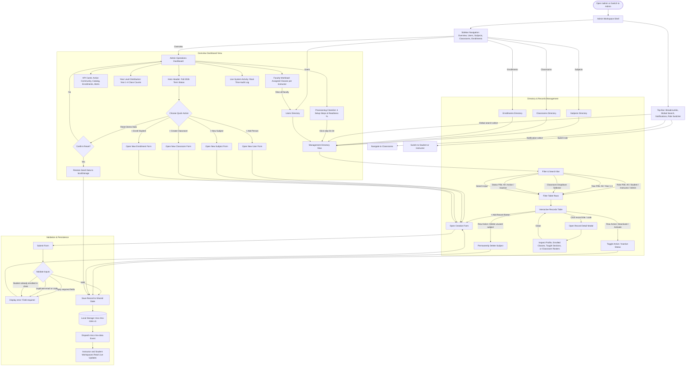

# Admin user flow

This flow describes the comprehensive administrative workspace in the TMCC LMS prototype. Open **Admin** from the top-bar role selector or navigate directly to `/admin`; there is no sign-in screen. All records are browser-local mock data synchronized across the Student, Instructor, and Admin workspaces.

**Standalone flowchart:** [Open the admin flow SVG](flowcharts/tmcc-admin-user-flow.svg).

## How to read this flow

### 1. Operations Overview (`AdminOverview.jsx`)
- **Hero Header & Quick Actions:** Displays current academic cycle status (`Fall 2026 Term · Active Academic Cycle`) and direct action buttons to quickly create people, subjects, classrooms, or enrollments, as well as a one-click demo data reset.
- **KPI Metrics:**
  - **Active Community:** Total active accounts with student and instructor counts.
  * **Catalog Offerings:** Accredited subject count and active class sections.
  * **Total Enrollments:** Roster count across active sections.
  * **Operational Alerts:** Highlights empty classrooms or unassigned instructors.
- **Academic Provisioning Checklist:** 4-step configuration progress (`Users` → `Subjects` → `Classrooms` → `Enrollments`) displaying completion percentage and direct jump links.
- **Classroom Distribution by Year Level:** Visual bar chart showing active class density across Year 1, Year 2, Year 3, and Year 4.
- **Faculty Workload:** Real-time table displaying course sections assigned per instructor.
- **Live System Activity:** Audit log reflecting user counts, active classrooms, and enrollment sync.

### 2. Directory & Records Management (`AdminDirectory.jsx`)
- **Users Directory:** Search and filter by role (`Students`, `Instructors`, `Admins`) and status (`Active`, `Inactive`). Clicking a user opens a modal displaying their profile, enrolled courses (for students), or assigned courses (for instructors).
- **Subjects Directory:** Academic catalog view with subject codes, titles, descriptions, and linked class section counts. Unreferenced subjects can be deleted; active subjects in use are protected.
- **Classrooms Directory:** Filter by Year Level (`Year 1` to `Year 4`) and status. Displays enrollment codes, assigned instructors, and enrolled student totals. Clicking a classroom opens its detail modal with the full student roster.
- **Enrollments Directory:** Filter by classroom selector and status. Displays enrolled students, sections, and terms.
- **Status Toggling:** Allows switching records between `active` and `inactive` states dynamically.

### 3. Data Integrity & Validation
- **Users:** Requires full name and unique email address.
- **Subjects:** Requires unique uppercase subject code and title.
- **Classrooms:** Requires subject selection, section name, and unique enrollment code. Generates starter syllabus module automatically.
- **Enrollments:** Requires classroom and student selection; blocks duplicate active enrollments.
- **Referenced Deactivation:** Records referenced by coursework, submissions, or classes are soft-deactivated to preserve history rather than deleted.

### 4. Cross-Role Reactivity & Storage
All actions persist to `localStorage` under `tmcc-lms-roles-v1` and trigger the `tmcc-lms-data` event via `useLmsData()`. Created subjects and classrooms immediately become available to instructors in `/instructor` and enrolled classes become visible to students in `/student`.

---

Implementation references:
- [Admin workspace shell](../src/roles/admin/Admin.jsx)
- [Admin overview dashboard](../src/roles/admin/AdminOverview.jsx)
- [Admin directory & modals](../src/roles/admin/AdminDirectory.jsx)
- [Admin styling](../src/roles/admin/adminDashboard.css)
- [Shared role data and seeds](../src/roles/shared/lmsData.js)
- [Local storage driver](../src/roles/shared/storage.js)

---

Implementation references:
- [Admin workspace shell](../src/roles/admin/Admin.jsx)
- [Admin overview dashboard](../src/roles/admin/AdminOverview.jsx)
- [Admin directory & modals](../src/roles/admin/AdminDirectory.jsx)
- [Admin styling](../src/roles/admin/adminDashboard.css)
- [Shared role data and seeds](../src/roles/shared/lmsData.js)
- [Local storage driver](../src/roles/shared/storage.js)

