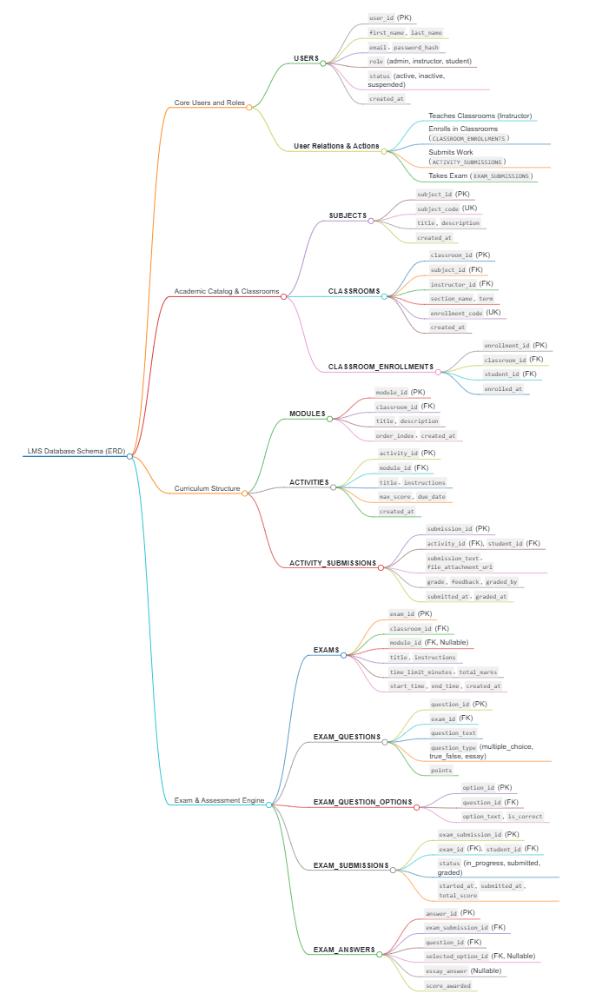

# Architecture and data flow

The app is a React and Vite frontend. `src/main.jsx` selects `/student`, `/instructor`, or `/admin`. `src/roles/student/StudentWorkspace.jsx` keeps the existing `src/App.jsx` dashboard as the visual and interaction reference. `src/roles/shared/RoleWorkspace.jsx` and its CSS provide the responsive Instructor/Admin shell, sidebar, mobile drawer, and role switching. `src/roles/shared/lmsData.js` seeds ERD-shaped demo records, while `storage.js` shares them through browser localStorage. `src/roles/instructor/Instructor.jsx` and `src/roles/admin/Admin.jsx` implement the other role workspaces.

The shared model follows the ERD: users, subjects, classrooms, enrollments, modules, materials, activities, activity submissions, exams, and exam submissions. Exam questions and their options are nested within each exam; answer and per-question-grade maps are nested within each submission. IDs link classroom records to their subjects, instructor, modules, and students. Materials and gradebook settings extend the supplied ERD for prototype needs.

## Supplied ERD

This is the schema reference supplied for the prototype. The frontend model adapts it for browser-local demonstration data.

Role setup, content, enrollments, and grades are stored under `tmcc-lms-roles-v1` in localStorage. Student assessment answers and completion continue to use the existing `gclass-student-workspace-v1` key. Student loads active enrolled classrooms and instructor-created exams, assignments, and materials from the role store when its page loads. Instructor review reads completed student attempts and assignment filename/comments, then saves grades and feedback to the role store. Multiple open tabs can overwrite role-store changes; this is a demonstration rather than shared multi-user storage.

Student quiz completion also records submitted answers and a timestamp in the shared role store so Admin activity/completion summaries and Instructor grading can reference the submission. Instructor review continues to use the existing student progress store for quiz answer details. Admin completion analytics includes earlier student quiz completions where available, but does not infer timestamps for those legacy records. New directory/content records store creation timestamps for recent activity panels. Admin activity uses area, bar, and line charts for weekly shared records; when no matching timestamped events exist, labeled preview series stay within the dashboard and do not mutate LMS data. The Total Students pie chart displays an explicitly illustrative sex breakdown because sex is not stored in student records. The responsive Admin bento grid puts this chart first; chart marks and pie segments expose values on hover or keyboard focus. Reports are available from the Admin System Administration sidebar group and CSV exports are generated from current local records.

Admin System Administration is an expandable group with dedicated pages. System configuration, terms, role-matrix values, and metadata-only audit events share `tmcc-lms-roles-v1`. `src/roles/shared/systemAdministrationData.js` owns migration, audit filtering/pagination, report rows, and full snapshot construction; `storage.js` stores the latest snapshot separately. The scheduled-job card is display-only. Reset Demo first stores the current shared state as a snapshot, then writes fresh seed data; it aborts if either storage operation fails. Role permissions remain visual and are not authorization controls. Audit summaries omit answers, submission text, comments, and feedback.

The current role UI is an initial connected prototype: exam authoring supports a single multiple-choice question, and assignment attachments store a filename and comment only. Essay grading, other question types, exam-wide timers and attempt/review policies, full enrollment editing, and a student roster picker remain outside this implementation slice even though the ERD and flow documents describe them.

## Boundaries

No backend, authentication, enforced authorization, active scheduler, off-device backup, upload service, or cross-device synchronization exists. The role picker is not a security boundary. Attachment selection stores a filename only, not the file contents. Answers and correct answers are present in the browser, so review settings and timers cannot prevent inspection or cheating. No real student data should be used.

Enumeration uses case-insensitive, order-independent exact matching; matching uses case-insensitive exact text in the corresponding order. Essays await manual grading. Gradebook values use the latest activity submission and the highest or latest graded exam attempt as configured. Category averages use graded items only, so an overall is illustrative and does not account for missing work. An overall is shown only after each non-zero weighted category has a grade.
