# Instructor end-to-end user flow

This is the current instructor prototype flow, traced from `src/roles/instructor/Instructor.jsx`, `InstructorClassroom.jsx`, `InstructorDashboardNews.jsx`, `InstructorAcademicCalendar.jsx`, and the shared role shell. Start at **Instructor** in the role picker or open `/instructor`. The workspace uses fictional demo identities and browser-local data; there is no sign-in screen.

**Standalone flowchart:** [Open the scalable instructor flowchart](flowcharts/tmcc-instructor-user-flow.svg). Connector letters in the SVG match the student chart convention: follow a letter to any corresponding letter elsewhere in the diagram.

```mermaid
flowchart TD
    START([Open /instructor]) --> IDENT[Load active fictional instructor]
    IDENT --> MULTI{More than one active instructor?}
    MULTI -->|Yes| CHOOSE[Choose instructor; class selection and year filter reset]
    MULTI -->|No| ASSIGNED{Any active classrooms assigned?}
    CHOOSE --> ASSIGNED
    IDENT --> ASSIGNED

    ASSIGNED -->|No| EMPTY[Show no-classrooms message and Open Admin link]
    EMPTY -->|My classes dropdown is still available| NEWCLASS
    ASSIGNED -->|Yes| HOME[Overview: Your teaching day]
    HOME --> OVERVIEW{Choose dashboard view}
    OVERVIEW -->|Overview| DASH[Review counts, assigned class cards, review previews, and current-month calendar]
    OVERVIEW -->|News & announcements| NEWS[Featured upcoming school notice, class notices, and school event list]
    DASH -->|Select a class card or All classrooms| A1((A))
    DASH -->|Review student work / open review queue| F1((F))
    DASH -->|Academic date markers| CAL[View current-month dates; markers are informational]
    CAL -->|View announcements| NEWS
    NEWS -->|Select a teacher announcement| B1((B))
    NEWS -->|View calendar| HOME
    NEWS -->|Carousel controls| NEWS

    IDENT --> TOOLS[Shared top bar: search, notifications, breadcrumbs, role switch]
    TOOLS -->|Search class result| A2((A))
    TOOLS -->|Search material or assessment result| CLASSES[Open Classes view; result is not opened directly]
    TOOLS -->|Select one of up to 5 submission notifications| F2((F))
    TOOLS -->|Breadcrumb home| HOME
    TOOLS -->|Switch role| ROLE[Open Student, Instructor, or Admin workspace]

    IDENT --> SIDEBAR[Sidebar: Overview, Gradebook, expandable My classes]
    SIDEBAR -->|Choose existing class| A3((A))
    SIDEBAR -->|+ Create class| K1((K))
    SIDEBAR -->|Gradebook| G1((G))
    A1 --> A4((A))
    A2 --> A4
    A3 --> A4
    A4 --> PICK[Choose a class; filter by All years or available year levels]
    PICK --> CLASS[Open class; choose among visible class tabs]
    K1 --> K2((K))
    K2 --> NEWCLASS[Create class: choose subject and year 1–4; enter section]
    NEWCLASS -->|Cancel| SIDEBAR
    NEWCLASS -->|Create| CLASSCREATED[Create browser-local classroom, class code, starter module, and default grade settings]
    CLASSCREATED --> CLASS
    CLASS --> HEADER[Class header: subject, year, section, term, enrolled count, and class code]
    HEADER --> TABS{Choose a class tab}

    TABS -->|Stream| STREAM[Read welcome post, up to 3 work updates, up to 2 material updates, upcoming 4 items, and About panel]
    STREAM -->|Upcoming / View classwork| D1((D))
    STREAM -->|View materials| C1((C))
    STREAM -->|Post class content| E1((E))
    TABS -->|Classwork| D2((D))
    TABS -->|Announcements| B2((B))
    TABS -->|Materials| C2((C))
    TABS -->|People| PEOPLE[Search active enrolled students by name or email]
    TABS -->|Submissions| F3((F))
    TABS -->|Create content| E2((E))

    D1 --> D3((D))
    D2 --> D3
    D3 --> WORK[Search and filter All work, Assignments, or Assessments]
    WORK -->|Create / no matching work| E3((E))
    WORK -->|Review published row, due date, points, and status| WORK

    B1 --> B2
    B2 --> ANNOUNCEMENTS[Read class notices; choose New announcement]
    ANNOUNCEMENTS --> COMPOSE[Enter required title up to 120 characters and message up to 1,200]
    COMPOSE -->|Cancel| ANNOUNCEMENTS
    COMPOSE -->|Post announcement| POSTED[Save class, instructor, timestamp, and active status]
    POSTED --> B3((B))
    B3 -->|Student-facing result| STUDENTNOTICE[Notice appears in connected Student class Stream]
    B3 -->|Instructor-facing result| NEWSNOTICE[Notice appears in instructor News & announcements]
    NEWSNOTICE -->|Select notice| B1

    C1 --> C3((C))
    C2 --> C3
    C3 --> MATERIALS[Browse class materials]
    MATERIALS -->|Add material| E4((E))
    MATERIALS -->|Student-facing result| STUDENTMAT[Material is shared through the connected Student workspace]

    E1 --> E2
    E3 --> E2
    E4 --> E2
    E2 --> E5((E))
    E5 --> CONTENT{Choose a content category}
    CONTENT -->|Material| MATFORM[Choose module; enter title, resource type, optional description]
    MATFORM -->|Save and share| MATSAVED[Add material to this class]
    MATSAVED --> C4((C))
    CONTENT -->|Assignment| ACTFORM[Choose module; enter title, instructions, due date, and points]
    ACTFORM --> ACTRULES[Set accept-late-work and allow-resubmission options]
    ACTRULES -->|Save and share| ACTSAVED[Add active assignment to this class]
    ACTSAVED --> D4((D))
    ACTSAVED --> I1((I))
    CONTENT -->|Assessment| EXFORM[Choose module; enter title, instructions, due date, points, and time limit]
    EXFORM --> QUESTION[Enter one question, four answer choices, and correct answer]
    QUESTION -->|Save and share| EXSAVED[Add active assessment to this class]
    EXSAVED --> D5((D))
    EXSAVED --> I1
    C4 --> MATERIALS
    D4 --> WORK
    D5 --> WORK
    I1 --> STUDENTWORK[Student opens assigned classwork and submits demo work]
    STUDENTWORK --> I2((I))

    F1 --> F4((F))
    F2 --> F4
    F3 --> F4
    I2 --> F4
    F4 --> REVIEW[Choose a pending submission for this class]
    REVIEW -->|Assignment| ACTREVIEW[Review student text and supplied attachment filename]
    REVIEW -->|Assessment| EXREVIEW[Review stored Student answers and local auto-score]
    ACTREVIEW --> SCORE[Enter final score and optional feedback]
    EXREVIEW --> SCORE
    SCORE --> VALID{Score from 0 through maximum?}
    VALID -->|No| SCORE
    VALID -->|Yes · Save grade| SAVEGRADE[Save grade and optional feedback to shared browser data]
    SAVEGRADE --> GRADED[Submission becomes graded and leaves pending queue]
    GRADED --> J1((J))
    J1 --> RESULT[Matching Student work detail shows the saved score and feedback]

    G1 --> G2((G))
    G2 --> GRADEBOOK[Choose an active classroom]
    GRADEBOOK --> SETTINGS[Edit activity weight, exam weight, and passing score]
    SETTINGS --> SUMMARY[Review graded record counts and category averages]
    SUMMARY -->|Breadcrumb home| HOME
```

### Connector key

- **A** — dashboard class cards, class search results, and the sidebar dropdown converge on assigned-class selection.
- **B** — instructor News opens a classroom announcement; publishing returns the notice to instructor News and the Student class Stream.
- **C** — Stream and Materials routes lead to the material list; **Add material** then crosses through **E** to the form and returns to the class list.
- **D** — classwork connects with the published assignment and assessment listings.
- **E** — Stream, Classwork, Materials, and Create content open the organized content form path.
- **F** — overview review actions, notifications, the Submissions tab, and demo student submissions converge on pending review.
- **G** — Gradebook navigation opens classroom settings and aggregate progress.
- **H** — instructor breadcrumbs return to Overview; role switching redirects to another workspace.
- **I** — saved classwork reaches the Student demo submission path and returns to instructor review.
- **J** — saving a grade updates the matching Student work detail; there is no standalone Student Grades page.
- **K** — the sidebar's Create class action opens the class form, including when there are no assigned classrooms.

## Code-based details

- **Initial state:** the page chooses the first active instructor by default. When several are active, a selector lets the demo user switch instructors. Active classrooms are filtered by the selected instructor. With no active classrooms, the normal dashboard is replaced by a no-classrooms message and an Admin link; the shared sidebar's **Create class** action remains available.
- **Overview:** the dashboard shows assigned classroom, awaiting review, active assessment, and active enrollment counts. Class cards show student and coursework counts. Year filters are **All years** plus year levels present in that instructor's assigned classrooms. The review panel previews at most three submissions. The calendar is a static current-month grid that marks academic events and class deadlines; dates are not links. Its **View announcements** control switches to News.
- **News & announcements:** the featured school announcement carousel can be changed with its controls. The teacher list includes active class announcements; selecting one opens that class's Announcements tab. The school event list shows up to six upcoming entries. **View calendar** returns to the Overview calendar.
- **Shared top bar:** search matches up to six displayed results from assigned classes, instructor materials, and assessments. A class result selects that class and opens Stream. A material or assessment result only changes to the Classes view; it does not open the specific result. Notifications contain up to five pending submissions and open the selected review. Breadcrumb home returns to Overview; the role switch navigates to Student, Instructor, or Admin.
- **Classes:** year-level filters are also available on the Classes page, which shows a chooser for the visible classrooms. The class header includes the subject, section, term, enrolled count, and enrollment code. Stream shows a static welcome post, up to three work updates, up to two material updates, up to four upcoming due items, and the About panel. Stream links into Classwork, Materials, or Create content.
- **Class tabs:** Classwork searches the selected class's assignment and assessment rows, and filters All, Assignments, and Assessments; rows show due date, points, and published status. People searches active enrolled student names and email addresses. Materials shows class resources. Announcements lists active class notices and provides a required title/message composer. Submissions lists only pending items for the selected class. Create content groups existing Materials, Assignments, and Assessments and shows their counts.
- **Create class:** the form requests subject, year level (1–4), and section. Saving makes an active browser-local classroom assigned to the selected instructor, generates a class code, creates a starter module, sets default gradebook settings (40% activity, 60% exam, 60 passing score), and opens the new class. It does not enroll students.
- **Create content:** the forms require a title and module. Materials additionally have one of four resource types (Study guide, Reading, Video, Practice set) and an optional description. Assignments also support instructions, due date, points, accept-late-work, and allow-resubmission. Assessments support instructions, due date, points, time limit (0 means none), one required question, four required answer choices, and one correct answer. The current instructor form creates one multiple-choice question.
- **Announcements:** posting requires a nonblank title and message (maximum 120 and 1,200 characters). Saving associates the notice with the selected class and instructor and timestamps it. It appears in the instructor News list and the connected Student class Stream. Cancel closes the composer.
- **Submissions and grading:** the overview hero, review list, notification menu, and class Submissions tab enter the same review flow. Assignment records in the browser role store include the submitted text and an optional attachment filename; no file is uploaded. Assessment attempts are assembled from the Student progress key and instructor exam data, then locally auto-scored from saved answers. The instructor enters a required final score between zero and the item's maximum and may add feedback. Saving updates the activity or exam submission in the shared role store and removes it from the pending queue. The score and feedback appear in the matching Student work detail after the Student workspace reloads. Already-graded exams are omitted from the pending queue.
- **Gradebook:** select an active classroom and edit category weights and passing score. The panel reports graded counts and averages for activities and exams. It does not display a per-student weighted report, and the numeric controls do not enforce that weights total 100.

## Completion and prototype limits

- Class creation completes when the new classroom opens with its starter module and defaults; enrollment remains an Admin/student enrollment task.
- Announcement completion means the notice is stored locally and shown in the instructor News view and Student class Stream. Material, assignment, and assessment records are shared through browser-local role data and appear in their related class views.
- A grade is complete when a valid score is saved. The submission is marked graded and removed from the pending queue. The Student sees the score and optional feedback in the matching work detail after returning to or refreshing the Student workspace; there is no standalone Student Grades page.
- There is no authentication, server persistence, real file upload, cross-device sync, or protected instructor authorization. Student progress and role data use separate browser storage keys; exam review reads completed Student answers and stores the final grade in role data. Demo class codes, attachment names, submissions, and scores are not official records.

Implementation references: [Instructor workspace](../src/roles/instructor/Instructor.jsx), [class tabs and forms](../src/roles/instructor/InstructorClassroom.jsx), [dashboard news](../src/roles/instructor/InstructorDashboardNews.jsx), [academic calendar](../src/roles/instructor/InstructorAcademicCalendar.jsx), [shared role shell](../src/roles/shared/RoleWorkspace.jsx), and [local data model](../src/roles/shared/lmsData.js).
