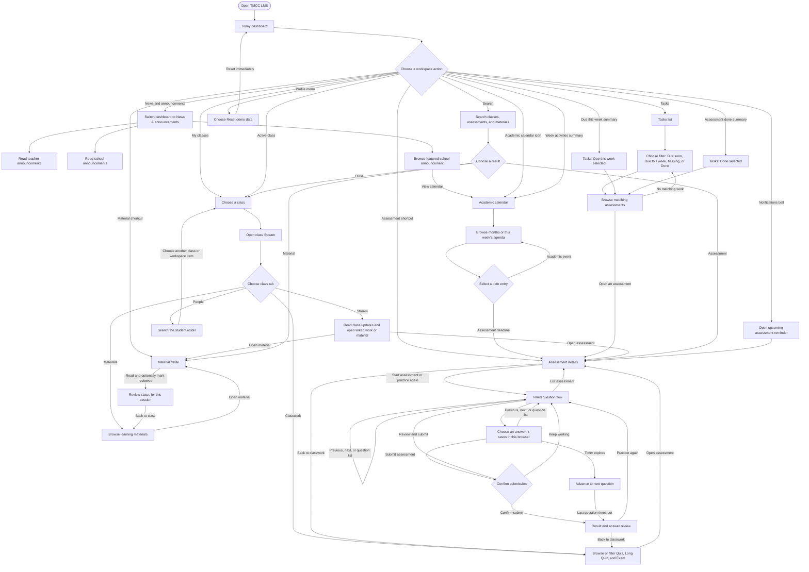

# Student user flow

This chart describes the student-facing flows implemented in the TMCC LMS prototype. Begin at **Today**; the prototype has no sign-in screen or server account. All names, classes, events, and assessments are fictional demo data.

**Standalone flowchart image:** [Open the scalable SVG](flowcharts/tmcc-student-user-flow.svg). It uses standard process, decision, start/end, and letter-connector symbols.

## How to read this flow

- **Today** is the starting point and the workspace breadcrumb returns to it. The dashboard can switch between Overview and News & announcements; its due, completed, activity, class, assessment, and material shortcuts open the corresponding workspace path.
- The **academic calendar** is opened from the top bar or the dashboard. Assessment entries lead to assessment details; school events are informational entries.
- **Tasks** groups assessments by due status. Selecting an assessment opens the same details view as calendar, notifications, search, and classwork.
- A **class** opens on Stream. Its tabs provide Stream, Classwork, Materials, and People. Assessment and material detail back buttons return to their matching class tab.
- During an assessment, each question has its own 60-second timer. Answers save to browser localStorage as the student works. Timeouts advance automatically; the final timeout submits. Manual submission asks for confirmation before showing the result.
- Assessment completion and answers persist in this browser. Material review state lasts only for the current app session. Reset demo data clears the saved assessment progress and returns to Today.

## Prototype boundaries

There is no authentication, server save, or cross-device sync. “Submit” records a local demo completion and displays a locally calculated result; instructor-created exams and saved instructor feedback are shared through browser storage. The academic calendar and class content are sample data, not an official TMCC schedule.

Implementation references: [workspace interactions](../src/App.jsx), [fictional classes and assessment data](../src/data.js), and [project scope](PROJECT_BRIEF.md).
