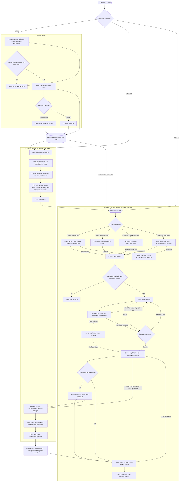

# TMCC LMS end-to-end system flow

This chart connects the admin, instructor, and student journeys through the shared browser data model. It follows the lifecycle from initial setup to student coursework, submission, grading, and grade review. The student section follows [Student user flow](STUDENT_USER_FLOW.md): the student workspace opens at Today, and dashboard, calendar, tasks, classwork, search, and notifications lead into the same assessment or material details. All records are fictional prototype data; each role opens directly without sign-in.

**Standalone system flowchart:** [Open the scalable end-to-end SVG](flowcharts/tmcc-system-end-to-end-flow.svg). It follows the student chart's standard start/end, process, decision, and connector notation.

## End-to-end stages

- **Provisioning:** Admin creates or edits users, subjects, classrooms, and enrollments. Valid changes are shared in browser storage; invalid forms remain open. Referenced records are deactivated to preserve history.
- **Course preparation:** An assigned instructor manages classroom enrollment and gradebook settings, then creates modules, materials, activities, and exams. Activities configure due, late, and resubmission behavior. Exams configure question types, timers, attempts, scoring, and answer review.
- **Student access:** A student sees active enrollments or joins with a classroom code. The student can open materials, submit an activity filename and comment, or take an available exam attempt.
- **Submission and grading:** Activity work and exam essays enter the instructor's review queue. Objective exam questions are scored locally. Saving instructor grades and feedback updates the same browser data the student reads.
- **Results:** The student reviews activity grades, exam scores, feedback, and answers permitted by the exam's review policy. The overall is illustrative and uses graded work only.

## Prototype boundary

The role picker is not authentication or authorization. Data is stored in one browser's localStorage, with no backend, actual file upload, audit trail, or cross-device sync. Exam answers and correct answers are available in client data; timers and review settings are demonstration behavior, not security controls. Use fictional data only.

Implementation references: [app routing and shared state](../src/main.jsx), [student workspace](../src/Student.jsx), [instructor workspace](../src/Instructor.jsx), [admin workspace](../src/Admin.jsx), [shared browser data and grading](../src/lmsData.js), and [system architecture](ARCHITECTURE.md).
